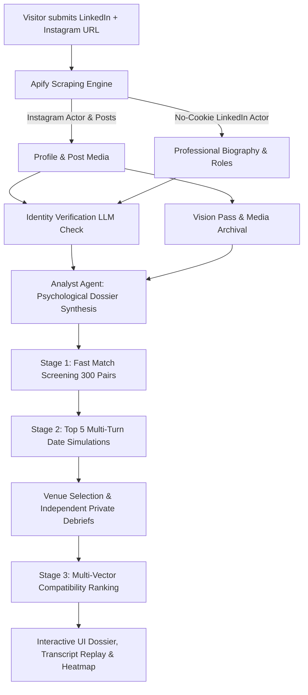

# Agentic Dating: Autonomous Agent Reconnaissance & Dating Swarm

Every person is represented by an AI agent, and the agents date each other on their persons' behalf. A visitor submits a public LinkedIn URL and a public Instagram URL. The platform scrapes both verified public sources with no user cookies required, an analyst agent synthesizes an evidence-backed psychological and lifestyle dossier, the person's agent goes on simulated multi-turn venue dates against top matches, and the user receives a ranked list of best fits with concrete evidence citations and private agent debriefs.

---

## 🏛️ System Architecture



---

## ⚡ The 4-Stage Pipeline

1. **Scraping & Identity Verification:**
   - **Instagram:** Scrapes bio, follower count, and recent posts (captions, tags, image URLs). Downloads media assets directly to local storage to prevent CDN expiry.
   - **LinkedIn:** No-cookie public profile scraping (harvests headlines, experience, summary, and skills).
   - **Identity Verification:** Cross-references name, location, and visual descriptors across platforms with an LLM verification step.
2. **Psychological Dossier (Analyst Agent):**
   - Vision pass extracts objective activity, scene, and mood tags from images.
   - Evidence-enforced synthesis creates Core Needs, Hobbies, Values, Personality, Lifestyle, Friction Points, and a ~150-word first-person Dating Persona.
   - **Strict Safety Rule:** Zero inference on sensitive categories (orientation, religion, health, ethnicity, politics).
3. **Simulated Multi-Turn Dates:**
   - **Stage 1 Quick Screen:** Rapid pairwise screening evaluates shared values and prospective tension.
   - **Stage 2 Dates:** Top 5 shortlisted candidates go on simulated 10-turn venue dates with grounded dialogue and private debriefs.
4. **Compatibility Ranking:**
   - Multi-vector formula: `0.55 * P_verdict + 0.20 * C_verdict + 0.25 * screen_score`.
   - Generates evidence-backed "Why This Fits" rationale and "Watch Out" friction warnings.

---

## 🛠️ Tech Stack & Scraping Configuration

| Layer | Technology |
|---|---|
| **Framework** | Next.js 14+ (App Router), TypeScript, Tailwind CSS, shadcn-inspired design |
| **Database** | SQLite via `better-sqlite3` in WAL mode (`data/dating.db`) |
| **Scraping** | Apify API (`apify-client`) |
| **Primary Actors** | `apify/instagram-profile-scraper`, `curious_coder/linkedin-profile-scraper` |
| **Fallback Actors** | `dev_rohit/linkedin-profile-scraper` |
| **LLM Provider** | Provider-agnostic wrapper in `lib/llm.ts` routed to Groq / OpenAI |
| **Telemetry** | Server-Sent Events (SSE) via `/api/jobs/[id]/stream` |

---

## 🔑 Environment Variables

```bash
APIFY_TOKEN=your_apify_api_token
GROK_API_KEY=your_groq_api_key
LLM_PROVIDER=openai
LLM_API_KEY=your_groq_api_key
LLM_BASE_URL=https://api.groq.com/openai/v1
LLM_MODEL_STRONG=openai/gpt-oss-120b
LLM_MODEL_FAST=qwen/qwen3.8-27b
LLM_VISION_MODEL=openai/gpt-oss-120b
DATABASE_URL=data/dating.db
ADMIN_KEY=agentic_admin_secret_key_2026
MAX_LIVE_SCRAPES_PER_IP_PER_DAY=3
DAILY_GLOBAL_SCRAPE_CAP=40
```

---

## 🚀 Getting Started

1. **Clone & Install:**
   ```bash
   npm install
   ```
2. **Seed & Pre-Populate Demo Cohort:**
   ```bash
   npm run seed
   npx tsx scripts/populate-demo.ts
   ```
3. **Run Development Server:**
   ```bash
   npm run dev
   ```
4. **Explore:**
   - Open `http://localhost:3000/` to test new profile links.
   - Open `http://localhost:3000/demo` for instant 25-person zero-latency gallery.
   - Open `http://localhost:3000/matrix` for the 25x25 compatibility heatmap.
   - Open `http://localhost:3000/admin` for administration.

---

## 💡 Cost Per Person & Efficiency

- **Quick Screen:** ~$0.001 per pair using fast models (`qwen/qwen3.8-27b`).
- **Simulated Dates:** ~$0.008 per multi-turn date using strong models (`openai/gpt-oss-120b`).
- **Total Pipeline Cost Per Live Submission:** Under ~$0.08 total per complete analysis and dating swarm run.

---

## 🔒 Privacy, Safety & Terms of Service

1. **Honesty Rule:** All persona traits are derived from public data. All dating conversations are simulated by LLM agents.
2. **Public Data Exclusivity:** No private logins, credentials, or cookies are ever harvested.
3. **Removal Right:** Anyone can request instant deletion of their profile, photos, and match rankings at `/about#removal`.
4. **ToS Compliance:** All scraping uses public endpoint access designed to honor rate limits and caching policies.
